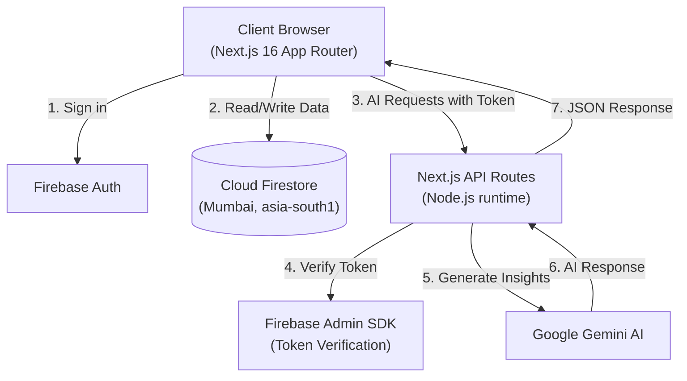

# Vespera

**Evening light. Exceptional homes.**

Vespera is an AI-guided home discovery app for renters in India. Swipe through curated rental listings while AI explains each property's fit with your preferences, intelligently reorders your deck based on your choices, and helps you make faster, more confident decisions.

## Project Status

| Feature | Status |
|---------|--------|
| Firebase Auth (Email, Google, Anonymous) | Working today |
| Property database with Firestore | Working today |
| Swipe deck interface | Working today |
| Like and skip functionality | Working today |
| User profiles and preferences | Working today |
| AI property explanations (Gemini) | Working today |
| Onboarding flow | In progress |
| AI-powered deck reranking | In progress |
| AI search | Planned |
| Interactive maps | Planned |
| Rental cost calculator | Planned |
| Shortlist comparison | Planned |
| AI copilot chat assistant | Planned |
| 3D landing page | Planned |
| Admin panel | Planned |

## Features

### Currently Working
- **User Authentication**: Sign in with email, Google, or try as a guest (anonymous auth)
- **Property Discovery**: Browse rental listings with detailed information, photos, and amenities
- **Swipe Interface**: Card-based swiping with smooth animations and keyboard shortcuts
- **Preference Tracking**: System tracks liked and skipped properties
- **AI Property Analysis**: Gemini AI provides detailed assessments of each property
- **Secure Data**: Production-ready Firestore security rules ensure data privacy

### Tech Stack

| Layer | Technology | Version |
|-------|------------|---------|
| Framework | Next.js (App Router) | 16.4.0 |
| UI Library | React | 19.3.0 |
| Language | TypeScript | 5.9.3 |
| Styling | Tailwind CSS | 4.3.3 |
| Animation | motion | 14.1.0 |
| Database & Auth | Firebase | 13.0.0 |
| Server Auth | Firebase Admin | 14.5.0 |
| AI Engine | Google GenAI SDK | 2.28.0 |
| State Management | Zustand | 5.0.15 |
| 3D Graphics | Three.js + React Three Fiber + Drei | 0.186.1 / 9.8.1 / 10.7.9 |
| Maps | Leaflet + React Leaflet | 1.9.4 / 5.0.0 |
| Icons | Lucide React | 1.55.0 |
| Smooth Scroll | Lenis | 1.3.26 |
| Notifications | Sonner | 2.0.8 |
| Validation | Zod | 4.6.5 |

<!-- TODO: hero GIF and screenshots in Phase 10 -->

## Architecture



## Getting Started

### Prerequisites

- Node.js 24.12.0 or newer
- npm (comes with Node)

### Installation

1. Clone the repository:
```bash
git clone https://github.com/icodesAS/Vespera.git
cd Vespera
```

2. Install dependencies:
```bash
npm install
```

3. Configure environment variables:

Copy `.env.example` to `.env.local` and add your configuration:

```env
# Firebase Client SDK (browser-safe, public)
NEXT_PUBLIC_FIREBASE_API_KEY=your_api_key
NEXT_PUBLIC_FIREBASE_AUTH_DOMAIN=your_project.firebaseapp.com
NEXT_PUBLIC_FIREBASE_PROJECT_ID=your_project_id
NEXT_PUBLIC_FIREBASE_STORAGE_BUCKET=your_project.firebasestorage.app
NEXT_PUBLIC_FIREBASE_MESSAGING_SENDER_ID=your_sender_id
NEXT_PUBLIC_FIREBASE_APP_ID=your_app_id

# Firebase Admin SDK (server-only, secret)
FIREBASE_ADMIN_CREDENTIALS_BASE64=your_base64_encoded_service_account

# Gemini AI (server-only, secret)
GEMINI_API_KEY=your_gemini_api_key
GEMINI_MODEL=gemini-3.8-flash
GEMINI_FALLBACK_MODEL=gemini-3.5-flash-lite
```

4. Run the development server:
```bash
npm run dev
```

Open [http://localhost:3000](http://localhost:3000) in your browser.

### Scripts

- `npm run dev` - Start development server (Turbopack)
- `npm run build` - Build production bundle
- `npm start` - Start production server
- `npm run lint` - Run ESLint
- `npm run typecheck` - Run TypeScript compiler checks
- `npm run check` - Run typecheck + lint + build (full validation)

## Security Notes

- All Gemini AI operations run server-side; API keys never reach the browser
- Firestore security rules enforce user-level access control
- Firebase Admin SDK verifies authentication tokens on all AI routes
- Only variables prefixed with `NEXT_PUBLIC_` are exposed to the client
- Never commit `.env.local` or `service-account.json` files

## Documentation

Comprehensive documentation is available in the `docs/` folder:

- `AGENTS.md` - Agent rules and project guidelines
- `docs/00-Decisions-Log.md` - Technical decisions and rationale
- `docs/01-Project-Overview.md` - Product features and roadmap
- `docs/02-Tech-Stack-and-Versions.md` - Dependency versions and constraints
- `docs/03-Firebase-and-Data.md` - Database schema and security rules
- `docs/04-UI-UX-and-3D-Design.md` - Design system and animations
- `docs/05-AI-Architecture.md` - AI integration and prompts
- `docs/06-Build-Phases-and-Prompts.md` - Development phases
- `docs/07-Risks-Debugging-and-Fixes.md` - Troubleshooting guide
- `docs/08-README-and-Portfolio-Plan.md` - Portfolio presentation

## Roadmap

- **Phase 2**: Enhanced data layer, seed properties, Zustand stores
- **Phase 3**: Complete design system and onboarding flow
- **Phase 4**: Advanced swipe deck with filters
- **Phase 5**: Full AI integration (explain, rerank, search)
- **Phase 6**: Onboarding quiz and explore page
- **Phase 7**: Property details, maps, shortlist, copilot chat
- **Phase 8**: Interactive 3D landing page
- **Phase 9**: Admin panel, accessibility, performance optimization
- **Phase 10**: Production deployment and documentation

## License

MIT

## Author

**Aman**  
GitHub: [@icodesAS](https://github.com/icodesAS)
