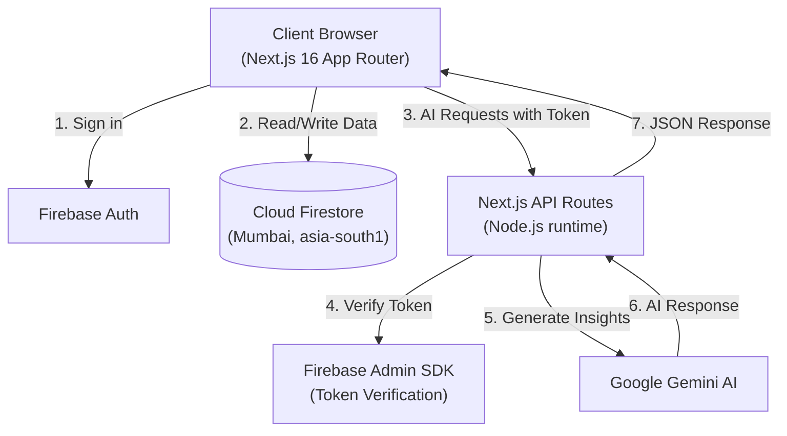

# Vespera

**Evening light. Exceptional homes.**

> An AI-guided home discovery app for renters in India. Swipe through curated rental listings while Gemini AI explains each property's fit, reorders your deck based on your choices, and helps you decide faster.


---

## What It Does

Vespera turns the frustrating process of renting a home in India into a fast, intelligent experience:

- **AI Property Analysis** — Gemini evaluates each listing against your stated preferences and explains in plain language why a home is or is not a good fit for you.
- **Dynamic Swipe Interface** — Card-based swiping with drag support, keyboard shortcuts, and smooth animations. Every like and skip is tracked.
- **Adaptive Deck Reranking** — The AI reorders your remaining deck as you swipe, surfacing more relevant listings over time.
- **Natural Language Search** — Ask "2BHK near Koramangala under ₹25,000" and the AI returns matching properties with ranked explanations.
- **Shortlist and Compare** — Save listings, then ask the AI to compare them and recommend the best fit.
- **Secure Data Privacy** — All AI operations run server-side. Your data and API keys never leave the server.

Demo data covers 20 fictional rental listings across Pune, Bengaluru, Mumbai, Hyderabad, Gurugram, Delhi, and other major Indian cities. It is for demonstration only and does not represent real properties.

---

## Tech Stack

| Layer | Technology | Version |
|---|---|---|
| Framework | Next.js (App Router) | 16.4.0 |
| UI Library | React | 19.3.0 |
| Language | TypeScript | 5.9.3 |
| Styling | Tailwind CSS | 4.3.3 |
| Animation | motion | 14.1.0 |
| Database and Auth | Firebase | 13.0.0 |
| Server Auth | Firebase Admin SDK | 14.5.0 |
| AI Engine | Google GenAI SDK | 2.28.0 |
| State Management | Zustand | 5.0.15 |
| 3D Graphics | Three.js + React Three Fiber + Drei | 0.186.1 / 9.8.1 / 10.7.9 |
| Maps | Leaflet + React Leaflet | 1.9.4 / 5.0.0 |
| Validation | Zod | 4.6.5 |
| Notifications | Sonner | 2.0.8 |
| Smooth Scroll | Lenis | 1.3.26 |
| Icons | Lucide React | 1.55.0 |

---

## Architecture



All AI requests from the browser carry a Firebase ID token. The API route verifies the token with the Admin SDK before calling Gemini. The API key never reaches the client.

---

## Getting Started

### Prerequisites

- Node.js 24.12.0 or newer
- npm (comes with Node)

### Installation

1. Clone the repository:

```bash
git clone https://github.com/icodesAS/Vespera.git
cd Vespera
```

2. Install dependencies:

```bash
npm install
```

3. Copy `.env.example` to `.env.local` and fill in your values:

```env
# Firebase Client SDK (browser-safe, public)
NEXT_PUBLIC_FIREBASE_API_KEY=your_api_key
NEXT_PUBLIC_FIREBASE_AUTH_DOMAIN=your_project.firebaseapp.com
NEXT_PUBLIC_FIREBASE_PROJECT_ID=your_project_id
NEXT_PUBLIC_FIREBASE_STORAGE_BUCKET=your_project.firebasestorage.app
NEXT_PUBLIC_FIREBASE_MESSAGING_SENDER_ID=your_sender_id
NEXT_PUBLIC_FIREBASE_APP_ID=your_app_id

# Firebase Admin SDK (server-only, never expose)
FIREBASE_ADMIN_CREDENTIALS_BASE64=your_base64_encoded_service_account

# Gemini AI (server-only, never expose)
GEMINI_API_KEY=your_gemini_api_key
GEMINI_MODEL=gemini-2.0-flash
GEMINI_FALLBACK_MODEL=gemini-2.0-flash-lite
```

4. Start the development server:

```bash
npm run dev
```

Open [http://localhost:3000](http://localhost:3000) in your browser.

### Scripts

| Command | What it does |
|---|---|
| `npm run dev` | Start development server (Turbopack) |
| `npm run build` | Build production bundle |
| `npm start` | Start production server |
| `npm run lint` | Run ESLint |
| `npm run typecheck` | Run TypeScript compiler checks |
| `npm run check` | Run typecheck + lint + build (full validation) |

---

## Security

- All Gemini AI calls are made server-side; the API key never reaches the browser
- Firestore security rules enforce per-user read and write access
- Firebase Admin SDK verifies authentication tokens on every AI route
- Only `NEXT_PUBLIC_` prefixed variables are exposed to the client
- Never commit `.env.local` or any service account file

---

## Documentation

Full technical documentation is in the `docs/` folder:

| File | Contents |
|---|---|
| `docs/00-Decisions-Log.md` | Technical decisions and rationale |
| `docs/01-Project-Overview.md` | Product features and page map |
| `docs/02-Tech-Stack-and-Versions.md` | Dependency versions and constraints |
| `docs/03-Firebase-and-Data.md` | Database schema and security rules |
| `docs/04-UI-UX-and-3D-Design.md` | Design system and animation tiers |
| `docs/05-AI-Architecture.md` | AI integration, prompts, and fallbacks |
| `docs/06-Build-Phases-and-Prompts.md` | Development phases |
| `docs/07-Risks-Debugging-and-Fixes.md` | Troubleshooting guide |
| `docs/08-README-and-Portfolio-Plan.md` | Portfolio presentation plan |

---

## Roadmap

- [x] Firebase Auth (email, Google, anonymous/guest)
- [x] Firestore property database
- [x] Swipe deck with drag, buttons, and keyboard shortcuts
- [x] AI property explanations (Gemini)
- [x] AI natural language search route
- [x] AI deck reranking route
- [ ] Onboarding preference quiz
- [ ] Property detail page with map and rent calculator
- [ ] Filters (city, rent, BHK, furnishing, pets)
- [ ] AI copilot chat (per property)
- [ ] Shortlist comparison with AI recommendation
- [ ] 3D landing page (Three.js / React Three Fiber)
- [ ] Explore grid with map toggle
- [ ] Admin panel
- [ ] Production deployment

---

## Author

**Aman**
GitHub: [@icodesAS](https://github.com/icodesAS)
