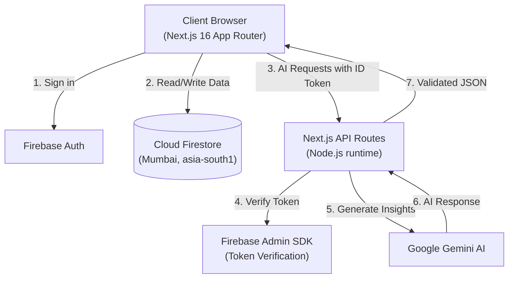

# Vespera

**Evening light. Exceptional homes.**

An AI-guided home discovery app for renters in India. Swipe through curated rental listings while Gemini AI explains each property's fit, reranks your deck in real time, and helps you decide faster and with more confidence.

<br/>

[](https://nextjs.org/)
[](https://www.typescriptlang.org/)
[](https://react.dev/)
[](https://tailwindcss.com/)
[](https://firebase.google.com/)
[](https://ai.google.dev/)
[](https://threejs.org/)
[](https://zod.dev/)
[](https://nodejs.org/)

---

## Overview

Vespera is a full-stack web application that rethinks how renters discover homes. Instead of manually scanning listings, users describe what they want — through an onboarding quiz or a natural language search — and the AI takes over: explaining each property, adapting the deck order to their revealed preferences, and eventually comparing shortlisted options side by side.

The goal is to demonstrate what a modern AI-integrated product looks like end to end: a real data layer (Firestore), a secured AI pipeline (server-side Gemini calls behind Firebase token verification), a responsive animated UI, and a 3D landing experience — all in a single Next.js 16 App Router codebase.

---

## Key Features

**AI Property Analysis**
Gemini evaluates each listing against the user's stored preferences and returns a match score, a ranked list of pros and cons, and a plain-language explanation. Every AI response is validated with Zod before it touches the UI, and a local fallback prevents blank states if the API is unavailable.

**Adaptive Deck Reranking**
After each swipe, the `/api/ai/rerank` route feeds the user's like/skip history back to Gemini and receives a reordered property ID list. The deck silently reorders so better-matching homes surface earlier without any visible disruption.

**Natural Language Search**
`/api/ai/search` accepts free-form queries ("pet-friendly 2BHK near Whitefield under ₹28k") and returns a filtered, AI-ranked subset of the property catalogue with per-result explanations.

**Shortlist and AI Comparison**
Users save properties to a shortlist. `/api/ai/summary` compares them and returns a structured recommendation — best overall fit, trade-offs, and the reasoning behind the ranking.

**Secure-by-Design AI Pipeline**
Every client request to an AI route carries a Firebase ID token. The route verifies it with Firebase Admin SDK before making any Gemini call. `GEMINI_API_KEY` is server-only and never serialised into client bundles.

**Authentication**
Email/password, Google OAuth, and anonymous (guest) sign-in via Firebase Auth. Anonymous accounts can be upgraded to a full account without losing saved preferences or liked properties.

---

## Tech Stack

| Layer | Technology | Version |
|---|---|---|
| Framework | Next.js App Router | 16.4.0 |
| Language | TypeScript (strict) | 5.9.3 |
| UI Library | React | 19.3.0 |
| Styling | Tailwind CSS v4 (CSS-first, no config file) | 4.3.3 |
| Animation | motion (formerly Framer Motion) | 14.1.0 |
| 3D / WebGL | Three.js + React Three Fiber + Drei + Postprocessing | 0.186.1 / 9.8.1 / 10.7.9 / 3.2.0 |
| Database | Cloud Firestore (Mumbai, asia-south1) | Firebase 13.0.0 |
| Authentication | Firebase Auth | Firebase 13.0.0 |
| Server Auth | Firebase Admin SDK | 14.5.0 |
| AI Engine | Google GenAI SDK (`@google/genai`) | 2.28.0 |
| Runtime Validation | Zod v4 | 4.6.5 |
| State Management | Zustand | 5.0.15 |
| Maps | Leaflet + React Leaflet | 1.9.4 / 5.0.0 |
| Smooth Scroll | Lenis | 1.3.26 |
| Notifications | Sonner | 2.0.8 |
| Icons | Lucide React | 1.55.0 |

**Tooling:** ESLint 9.x · TypeScript compiler (`tsc --noEmit`) · Turbopack (default dev bundler) · Node.js 24.12+

---

## Architecture



The client never calls Gemini directly. All AI routes sit behind Firebase token verification — an unauthenticated request returns 401 before any AI call is made. AI responses are parsed and validated with Zod; if the schema check fails, the route returns a structured fallback instead of propagating a broken response to the UI.

### AI Route Map

| Route | Purpose |
|---|---|
| `POST /api/ai/explain-property` | Score and explain a single property against user preferences |
| `POST /api/ai/rerank` | Reorder remaining deck based on like/skip history |
| `POST /api/ai/search` | Natural language property search with ranked results |
| `POST /api/ai/summary` | Compare shortlisted properties and recommend the best fit |

---

## Project Structure

```
app/
  (marketing)/        landing page "/"
  (app)/              discover, explore, property/[id], shortlist, onboarding
  api/ai/             explain-property, search, rerank, summary, chat
components/
  ui/                 shared primitives
  discover/           swipe deck, filter pills, search bar
  property/           detail page, image gallery, map, rent helper
  ai/                 explain panel, copilot chat, comparison view
  three/              WebGL components (landing hero, ambient background)
lib/
  firebase.ts         Firebase client SDK initialisation
  ai.ts               Gemini SDK wrapper and prompt builders
  auth-server.ts      Firebase Admin token verification
  env.ts              Typed environment variable access
schemas/              Zod schemas: property, user, AI responses
store/                Zustand stores (properties, preferences, UI state)
hooks/                useAuth.tsx
types/                property.ts, shared interfaces
data/                 properties.ts (20 demo listings), landmarks.ts
docs/                 full technical documentation (9 files)
```

---

## Getting Started

### Prerequisites

- Node.js 24.12.0 or newer
- npm (comes with Node)

### Installation

1. Clone the repository:

```bash
git clone https://github.com/icodesAS/Vespera.git
cd Vespera
```

2. Install dependencies (exact versions, no ranges):

```bash
npm install
```

3. Copy `.env.example` to `.env.local` and fill in your values:

```env
# Firebase Client SDK — safe to expose to the browser
NEXT_PUBLIC_FIREBASE_API_KEY=your_api_key
NEXT_PUBLIC_FIREBASE_AUTH_DOMAIN=your_project.firebaseapp.com
NEXT_PUBLIC_FIREBASE_PROJECT_ID=your_project_id
NEXT_PUBLIC_FIREBASE_STORAGE_BUCKET=your_project.firebasestorage.app
NEXT_PUBLIC_FIREBASE_MESSAGING_SENDER_ID=your_sender_id
NEXT_PUBLIC_FIREBASE_APP_ID=your_app_id

# Firebase Admin SDK — server-only, never expose
FIREBASE_ADMIN_CREDENTIALS_BASE64=your_base64_encoded_service_account

# Gemini AI — server-only, never expose
GEMINI_API_KEY=your_gemini_api_key
GEMINI_MODEL=gemini-2.0-flash
GEMINI_FALLBACK_MODEL=gemini-2.0-flash-lite
```

Only variables prefixed with `NEXT_PUBLIC_` are bundled into the client. Admin credentials and the Gemini key remain server-side.

4. Start the development server:

```bash
npm run dev
```

Open [http://localhost:3000](http://localhost:3000).

### Scripts

| Command | Description |
|---|---|
| `npm run dev` | Development server with Turbopack |
| `npm run build` | Production build |
| `npm start` | Serve the production build |
| `npm run lint` | ESLint across the whole project |
| `npm run typecheck` | TypeScript strict type check (`tsc --noEmit`) |
| `npm run check` | Full gate: typecheck + lint + build |

`npm run check` must pass with zero errors before any change is considered done.

---

## Security Model

- Gemini API key is server-only; Next.js never serialises it into client bundles
- Every AI route verifies a Firebase ID token with Admin SDK before calling Gemini
- Firestore security rules enforce per-user document access at the database level
- All Firestore reads and AI responses are parsed through Zod schemas before use
- Only `NEXT_PUBLIC_` variables reach the browser; there is no other client-side secret surface
- `.env.local` and service account files are git-ignored and must never be committed

---

## Documentation

Full technical documentation lives in `docs/`:

| File | Contents |
|---|---|
| `docs/00-Decisions-Log.md` | Architecture decisions and rationale |
| `docs/01-Project-Overview.md` | Product features, page map, and acceptance criteria |
| `docs/02-Tech-Stack-and-Versions.md` | Exact dependency versions and upgrade constraints |
| `docs/03-Firebase-and-Data.md` | Firestore schema, security rules, and data model |
| `docs/04-UI-UX-and-3D-Design.md` | Design system, animation tiers, and WebGL usage rules |
| `docs/05-AI-Architecture.md` | AI routes, prompt design, validation, and fallbacks |
| `docs/06-Build-Phases-and-Prompts.md` | Phased development plan |
| `docs/07-Risks-Debugging-and-Fixes.md` | Known risks and troubleshooting guide |
| `docs/08-README-and-Portfolio-Plan.md` | Portfolio presentation plan |

---

## Roadmap

**Shipped**
- [x] Firebase Auth — email/password, Google OAuth, anonymous guest sign-in
- [x] Cloud Firestore property database with Zod-validated reads and writes
- [x] Swipe deck — drag gestures, keyboard shortcuts, animated transitions
- [x] AI property explanation route (`/api/ai/explain-property`)
- [x] AI natural language search route (`/api/ai/search`)
- [x] AI deck reranking route (`/api/ai/rerank`)
- [x] AI shortlist summary route (`/api/ai/summary`)
- [x] Firestore security rules (production-grade, per-user access)

**In progress**
- [ ] Onboarding preference quiz (budget, cities, BHK, priorities)
- [ ] Design system and global layout (Tailwind v4 tokens, motion tiers)

**Planned**
- [ ] Swipe deck wired to live AI reranking
- [ ] Property detail page — gallery, map, rent calculator, AI copilot chat
- [ ] Filters — city, rent range, BHK, furnishing, pet-friendly
- [ ] Shortlist comparison page with AI recommendation
- [ ] Explore grid with Leaflet map toggle
- [ ] 3D landing page (Three.js / React Three Fiber / Postprocessing)
- [ ] Admin panel — add, edit, and seed demo properties
- [ ] Production deployment

---

## Data Notice

The 20 rental listings in this project are fictional demo data created for development and portfolio purposes. They do not represent real properties, landlords, or available rentals.

---

## Author

**Aman**
GitHub: [@icodesAS](https://github.com/icodesAS)
