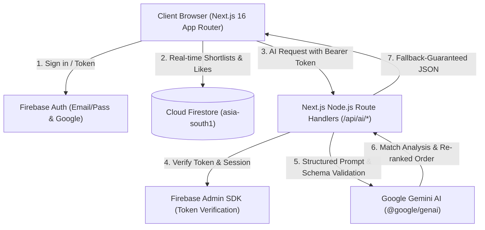
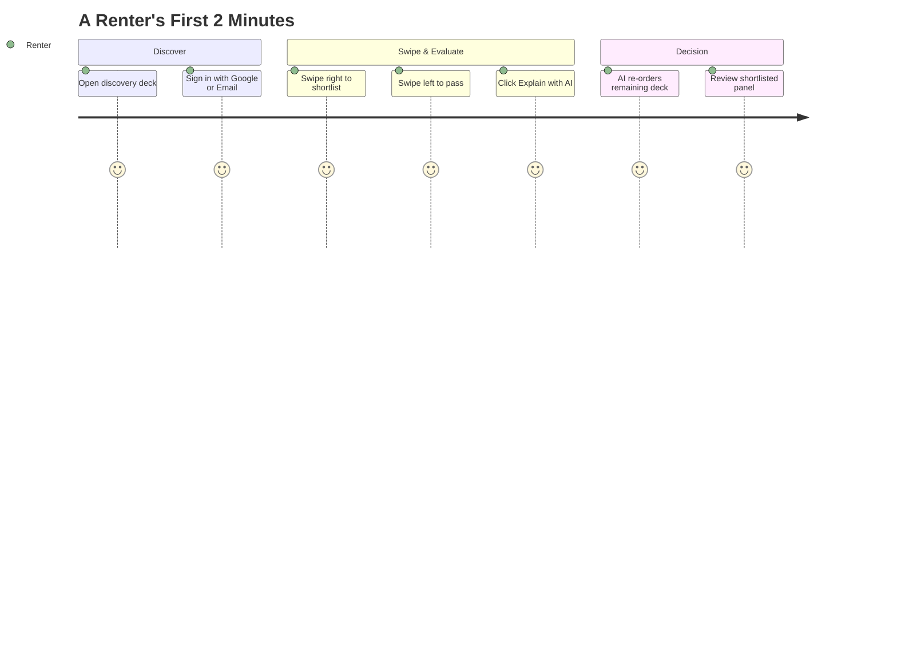

# PropSwipe 🏠✨

> **AI-Powered Rental Discovery Engine for Indian Metros**  
> Swipe right to shortlist, swipe left to skip, and get instant Gemini AI match evaluations, automated taste re-ranking, and localized insights.

[](https://nextjs.org/)
[](https://react.dev/)
[](https://www.typescriptlang.org/)
[](https://tailwindcss.com/)
[](https://firebase.google.com/)
[](https://ai.google.dev/)
[](https://threejs.org/)

---

## 💡 Why PropSwipe?

Searching for rental homes in Indian tech hubs (Bengaluru, Pune, Gurugram, Mumbai) is notoriously cluttered. Renters scroll through endless unvetted portals, misleading brokerage listings, and walls of repetitive text.

* **The Problem:** Renter fatigue caused by information overload, uncurated listings, and no instant way to evaluate if a flat actually meets commute, budget, and lifestyle requirements.
* **The Solution:** A rapid, swipe-driven card discovery interface that eliminates cognitive load. You review one property at a time, shortlisting or passing in milliseconds.
* **The AI Advantage:** Google Gemini acts as your on-demand real estate analyst — explaining exact pros and cons against your budget, dynamically re-ordering unseen homes based on your taste patterns, and answering natural language queries.

---

## ✨ Features

- **🎯 Fluid Swipe Discovery Deck:** Card interface powered by gesture-driven physics (`motion/react`), keyboard shortcuts, and smooth micro-interactions.
- **🤖 Gemini AI Match Copilot:**
  - **Instant Property Breakdown:** Evaluates budget alignment, IT hub connectivity, bedroom requirements, and safety with honest pros and cons.
  - **Taste-Based Deck Re-ranking:** Analyzes the homes you liked vs. skipped to dynamically prioritize the most relevant listings in your remaining deck.
  - **Natural Language AI Search:** Search in plain English (e.g., *"quiet 2BHK under 35k in Pune near metro"*) and let Gemini find matching properties.
- **🔒 Enterprise-Grade Security:**
  - Token-verified API route handlers protected via Firebase Admin SDK.
  - Strict Firestore security rules ensuring renters only modify their own shortlist data.
  - Server-side only Gemini execution — zero API keys exposed to the client.
- **🇮🇳 Localized for Indian Cities:** Rent in INR (₹/mo), deposit structures, furnishing states (Furnished, Semi-Furnished, Unfurnished), and IT corridor neighborhood tags.

---

## 🏗️ Architecture & Data Flow



### User Journey



---

## 🛠️ Tech Stack

| Layer | Technology | Version | Purpose |
|---|---|---|---|
| **Framework** | Next.js (App Router) | `16.4.0` | Turbopack dev, server components, API routes |
| **UI Library** | React | `19.3.0` | Latest concurrent UI engine |
| **Language** | TypeScript | `5.9.3` | Strict end-to-end type safety |
| **Styling** | Tailwind CSS | `4.3.3` | CSS-first modern utility engine |
| **Motion** | `motion/react` | `14.1.0` | Hardware-accelerated card gestures & fluid transitions |
| **Database & Auth** | Firebase & Firebase Admin | `13.0.0` / `14.5.0` | Client auth, Firestore security rules, server token auth |
| **AI Engine** | Google GenAI SDK | `2.28.0` | Gemini 3.8 Flash / 3.5 Flash Lite decision engine |
| **3D Graphics** | Three.js + R3F + Drei | `0.186.1` / `9.8.1` | Lazy-loaded interactive 3D hero scene |
| **State** | Zustand | `5.0.15` | Client-side reactive property & swipe deck store |

---

## 🚀 Getting Started

### Prerequisites

- **Node.js**: `24.12.0` or higher (`node -v`)
- **npm**: `11.x` (`npm -v`)

### Installation

1. **Clone the repository:**
   ```bash
   git clone https://github.com/icodesAS/PropSwipe.git
   cd PropSwipe
   ```

2. **Install pinned dependencies:**
   ```bash
   npm install
   ```

3. **Configure Environment Variables:**
   Create a `.env.local` file in the project root:
   ```env
   # Firebase Client SDK
   NEXT_PUBLIC_FIREBASE_API_KEY=your_firebase_api_key
   NEXT_PUBLIC_FIREBASE_AUTH_DOMAIN=your_project.firebaseapp.com
   NEXT_PUBLIC_FIREBASE_PROJECT_ID=your_project_id
   NEXT_PUBLIC_FIREBASE_STORAGE_BUCKET=your_project.firebasestorage.app
   NEXT_PUBLIC_FIREBASE_MESSAGING_SENDER_ID=your_sender_id
   NEXT_PUBLIC_FIREBASE_APP_ID=your_app_id

   # Firebase Admin SDK (Server-Side)
   FIREBASE_ADMIN_CREDENTIALS_BASE64=your_base64_service_account_json

   # Gemini AI
   GEMINI_API_KEY=your_gemini_api_key
   GEMINI_MODEL=gemini-3.8-flash
   GEMINI_FALLBACK_MODEL=gemini-3.5-flash-lite
   ```

4. **Run Development Server:**
   ```bash
   npm run dev
   ```
   Open [http://localhost:3000](http://localhost:3000) in your browser.

5. **Verify Build & Types:**
   ```bash
   npm run check
   ```

---

## 🛡️ Security & Reliability Principles

1. **Zero Secrets in Client Bundles:** All Gemini AI calls and administrative database actions occur inside server route handlers (`app/api/**`).
2. **Graceful Fallbacks:** Every AI route is engineered with non-AI algorithmic fallbacks. If the Gemini API experiences network disruption (e.g. rate limit or 503), the UI never crashes or presents blank screens.
3. **Database Additive Only:** Existing collections and properties maintain backward compatibility without breaking existing users.
4. **Strict Type Validation:** All external data (Firestore reads, request payloads, AI outputs) pass through strict TypeScript and Zod validation.

---

## 🗺️ Roadmap

- [x] **Phase 1:** Clean foundation, pinned dependency tree, Firebase Auth & Firestore setup, Gemini v2 integration.
- [ ] **Phase 2:** Database & Auth hardening, user profile onboarding, admin verification, swipe history persistence.
- [ ] **Phase 3:** Dark-mode design system overhaul with fluid card physics & micro-animations.
- [ ] **Phase 4:** Interactive 3D hero scene (Three.js / React Three Fiber).
- [ ] **Phase 5:** Leaflet interactive transit map & neighborhood amenities scanner.
- [ ] **Phase 6:** Streaming Gemini Rental Copilot chat assistant.

---

## 📄 License

This project is licensed under the MIT License — see the [LICENSE](LICENSE) file for details.
