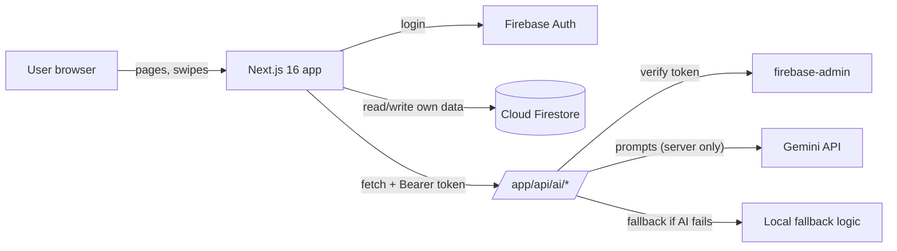
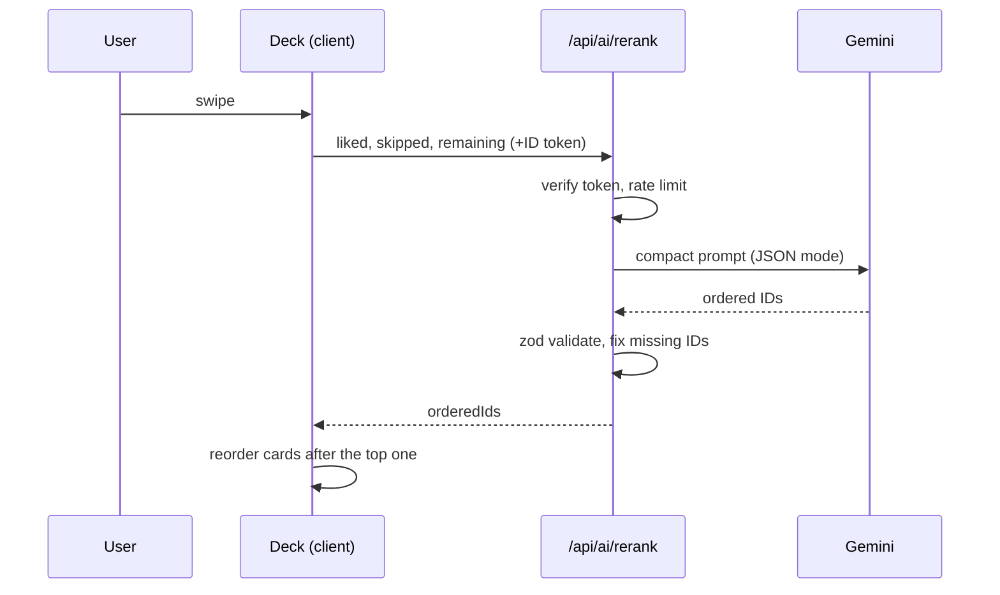

# 03 — Technical Architecture

## 1. Big picture

Rule: the browser never talks to Gemini. The browser sends its Firebase login token to our API routes; routes check it, call Gemini, validate the answer, and reply.

## 2. Folder structure (target)
```
propswipe/
├── AGENTS.md  GEMINI.md  .env.example  firestore.rules  package.json
├── docs/                      # this folder (agent context)
├── app/
│   ├── layout.tsx             # fonts + AuthProvider + <Toaster/>
│   ├── globals.css            # Tailwind import + design tokens
│   ├── page.tsx               # NEW landing (3D hero)
│   ├── discover/page.tsx      # MOVED from old app/page.tsx
│   ├── onboarding/page.tsx    # NEW
│   ├── property/[id]/page.tsx # NEW (server component, awaits params)
│   ├── login/page.tsx         # existing (restyle)
│   ├── admin/page.tsx         # existing (+ admin check, + seed import)
│   └── api/ai/
│       ├── explain-property/route.ts   # existing -> upgrade (keep path!)
│       ├── search/route.ts             # existing -> upgrade
│       ├── rerank/route.ts             # existing -> wire to UI
│       ├── summary/route.ts            # existing -> wire to UI
│       └── copilot/route.ts            # NEW (streaming)
├── components/
│   ├── ui/        # Button, Chip, GlassCard, Slider, Skeleton, Badge
│   ├── layout/    # Header, Footer, PageShell
│   ├── deck/      # SwipeablePropertyCard, SwipeDeck, SwipeControls
│   ├── property/  # PropertyCard, PropertyGallery, PropertyFacts, PropertyMap
│   ├── filters/   # FilterBar, RentSlider, CityChips
│   ├── ai/        # AiSearchBar, ExplainSheet, CompareSheet, CopilotDrawer
│   └── three/     # HeroScene, Particles, FloatingCards, SceneFallback
├── hooks/  useAuth.tsx (existing)  useRequireAuth.ts  useReducedMotion3D.ts  useAiFetch.ts
├── store/  usePropertyStore.ts (existing)  useFilterStore.ts  useCopilotStore.ts
├── lib/
│   ├── firebase.ts            # existing client init (keep path)
│   ├── firebase-admin.ts      # NEW server only
│   ├── api-auth.ts            # NEW verify Bearer token + rate limit
│   ├── ai.ts                  # existing: Gemini client (API key only)
│   ├── ai-json.ts             # NEW generateJSON(): call -> parse -> zod -> retry -> fallback model
│   ├── ai-prompts.ts          # NEW all prompt text in one place
│   ├── ai-fallbacks.ts        # NEW non-AI backups (explain/search/rerank/summary)
│   ├── normalize-property.ts  # NEW map old/legacy fields -> new Property
│   └── filters.ts             # NEW apply filters + (de)serialize to URL
├── data/properties.ts         # 20 seed homes (keep)
├── types/property.ts  types/user.ts  types/ai.ts
└── public/images/  (prop1..prop20.jpg — compress, keep names)
```

## 3. Data model (Firestore) — additive only

### `users/{uid}` (existing doc, new optional fields)
```ts
// types/user.ts
export interface UserDoc {
  uid: string; email: string; displayName: string | null;
  createdAt: unknown;                       // serverTimestamp (existing)
  likedPropertyIds: string[];               // existing
  lastAiPreferenceText?: string | null;     // existing (keep)
  // NEW (all optional so old users still load):
  skippedPropertyIds?: string[];
  onboardingComplete?: boolean;
  preferences?: UserPreferences;
}
export interface UserPreferences {
  cities: string[];                 // ["Pune","Bengaluru"]
  budgetMin: number; budgetMax: number;   // INR per month
  bhk: number[];                    // [1,2]
  furnishing: "any" | "furnished" | "semi-furnished" | "unfurnished";
  mustHaves: string[];              // ["pet-friendly","parking","near-metro"]
  note?: string;                    // "near EON IT Park"
  updatedAt?: string;               // ISO
}
```

### `properties/{docId}` (existing, new optional fields)
```ts
// types/property.ts  (REMOVE the old `[key: string]: unknown` index signature in Phase 2; use the normalizer instead)
export interface Property {
  id: string; title: string; city: string; location: string;
  rent: number; bedrooms: number; bathrooms: number; areaSqFt: number; imageUrl: string;
  // NEW optional:
  images?: string[];
  furnishing?: "furnished" | "semi-furnished" | "unfurnished";
  propertyType?: "apartment" | "villa" | "independent-house" | "pg";
  amenities?: string[]; petFriendly?: boolean;
  description?: string; deposit?: number; availableFrom?: string; // ISO date
  lat?: number; lng?: number;
  status?: "active" | "hidden";             // missing = active
  createdAt?: string; createdBy?: string;
}
```
`normalizeProperty(raw: unknown): Property | null` maps legacy names (`beds`->`bedrooms`, `baths`->`bathrooms`, `areaSqft`->`areaSqFt`, `rentPrice`->`rent`), fills safe defaults, and returns null for unusable data. **All Firestore reads go through it.** Keep the old `price` field in the database; just do not rely on it in the UI.

### `admins/{uid}` (new, tiny)
Empty document. Created by hand in the Firebase console. Exists = admin.

## 4. Server helpers (the safety layer)

### `lib/firebase-admin.ts`
Initialises firebase-admin once, from `FIREBASE_ADMIN_CREDENTIALS_BASE64` (base64 JSON). Server only. Guard against double init.

### `lib/api-auth.ts`
```ts
export async function requireUser(req: Request): Promise<{ uid: string }>
// 1. read "Authorization: Bearer <idToken>"
// 2. getAuth().verifyIdToken(token)
// 3. rate limit per uid: 30 AI calls / 10 min (in-memory Map; fine for a demo, resets on cold start)
// throws an object { status: 401 | 429, message } -> route returns JSON + status
```
Every AI route starts with `const { uid } = await requireUser(req)`. Routes that use it set `export const runtime = "nodejs"`.

### `lib/ai-json.ts`
```ts
export async function generateJSON<T>(opts: {
  prompt: string; schema: z.ZodType<T>; systemInstruction?: string;
}): Promise<{ ok: true; data: T } | { ok: false; reason: string }>
```
Steps: call `ai.models.generateContent({ model: process.env.GEMINI_MODEL, contents, config: { responseMimeType: "application/json", systemInstruction } })` -> `JSON.parse` -> `schema.safeParse`. On failure: retry once with the fallback model. If still failing: return `{ ok:false }` and the route uses `ai-fallbacks.ts`.
**After installing, open the `@google/genai` README/types once and confirm the exact `config` field names for this version. Do not guess.**

### Token cost control
Never send full property objects to Gemini. Send a compact array: `{id,title,city,rent,bedrooms,areaSqFt,furnishing,amenities}`; cap at 60 items; trim strings.

## 5. API contracts (keep existing paths so nothing breaks)
All routes: `POST`, JSON body, header `Authorization: Bearer <Firebase ID token>`. Reply always includes `{ source: "ai" | "fallback" }`.

| Route | Request | Response |
|---|---|---|
| `/api/ai/explain-property` | `{ property, preferences? }` | `{ bullets: string[3..4], verdict: "great"\|"good"\|"okay"\|"poor", source }` |
| `/api/ai/search` | `{ query, properties: CompactProperty[] }` | `{ filters: { city?, maxRent?, minRent?, bhk?, furnishing? }, rankedIds: string[], understood: string, source }` |
| `/api/ai/rerank` | `{ liked: CompactProperty[], skipped: CompactProperty[], remaining: CompactProperty[] }` | `{ orderedIds: string[], reason: string, source }` (client ignores unknown IDs and appends any missing ones) |
| `/api/ai/summary` | `{ selected: CompactProperty[], preferences? }` | `{ summary: string, tradeoffs: string[], topPicks: { id, why }[2..3], source }` |
| `/api/ai/copilot` | `{ propertyId?, property?, preferences?, messages: {role,content}[] (max 8) }` | streamed text (`text/plain`, chunked). Final chunk is plain text; no JSON. |

Existing route behavior must keep working for the old callers until the new UI replaces them. If a request body is the OLD shape, still accept it (zod `.or()`), then remove in a later cleanup.

## 6. Client state (Zustand)
- `usePropertyStore` (existing): `properties, currentIndex, likedIds, skippedIds` + new `swipeCount`, `undoLast()`, `applyAiOrder(ids)` (reorders only indexes > currentIndex).
- `useFilterStore` (new): `{ city[], minRent, maxRent, bhk[], furnishing, sort }` + `toQueryString()` / `fromQueryString()`.
- `useCopilotStore` (new): `{ open, messages, streaming }`.
Persist to Firestore: liked + skipped (debounced 800 ms), preferences (on submit). Keep the existing `persistToFirestore()` name.

## 7. Auth flow (unchanged logic, safer)
`useAuth` provides `user, loading`. `useRequireAuth()` redirects to `/login?next=<path>`. `isAdmin` = `getDoc(admins/uid).exists()` (allowed by the rules). API routes verify the token themselves; the client guard is only for UX.

## 8. Property detail page (server component)
```tsx
// app/property/[id]/page.tsx
export default async function Page({ params }: { params: Promise<{ id: string }> }) {
  const { id } = await params;                    // REQUIRED in Next 16
  const property = await getPropertyById(id);     // admin SDK read, falls back to seed data
  if (!property) notFound();
  return <PropertyView property={property} />;    // client component for interactivity
}
export async function generateMetadata({ params }: { params: Promise<{ id: string }> }) { /* title + og:image */ }
```
`getPropertyById` order: Firestore (admin SDK) -> seed array -> null. Wrapped in try/catch so a Firestore outage never gives a 500.

## 9. AI sequence (rerank example)


## 10. Testing (keep it small but real)
- `npm run check` always.
- Manual script (5 min) in doc 07 "Smoke test".
- Optional later: Vitest for `lib/filters.ts`, `normalize-property.ts`, and zod schemas (pure functions = easy tests). Add Vitest only through the decision log process.
