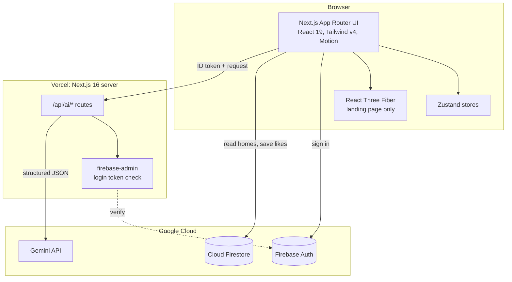
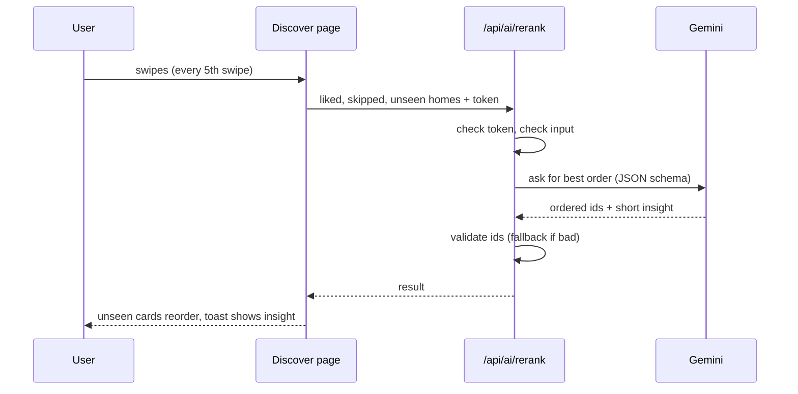
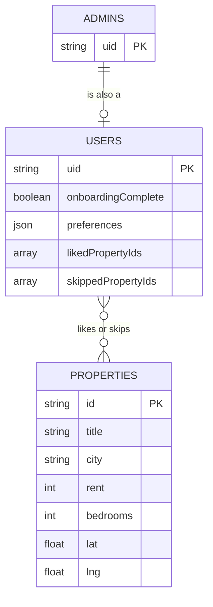
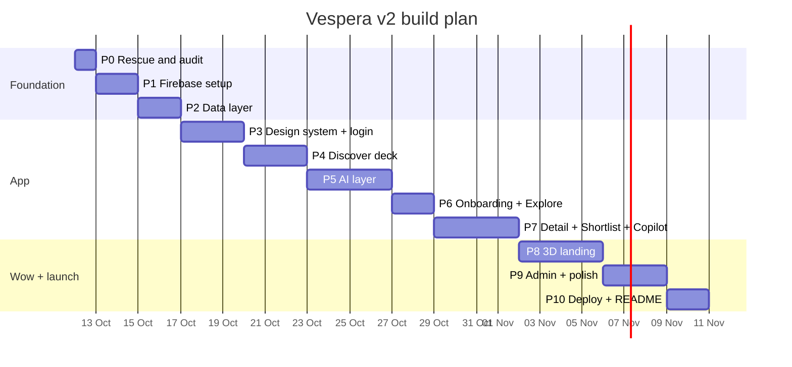

# 08 — README and Portfolio Plan (do this at the END, Phase 10)

**Plain-English summary:** The README is your project's front door. A recruiter decides in about 10 seconds whether to keep reading.
So the top of the README must show: **what it is (one line), a moving picture (GIF/video), a live link, and the tech badges.**
Below that: features, diagrams, how the AI works, how to run it, and what you learned. This file gives you the plan, the diagrams
(ready to paste), the media checklist and the skeleton. **Fill in real numbers only after you measure them. Never invent stats.**

## 1. Media checklist (capture after Phase 9)
Make the folder `docs/media/`. Use these exact names so the README links never break.

| File | What to capture | Tips |
|------|-----------------|------|
| `hero.gif` (≤ 8 MB) | 10–12 s loop: 3D landing → scroll → click Start | record at 1280×720 |
| `swipe.gif` | 8 s: swipe right/left, undo, toast "AI is learning" | phone-size window 390×844 |
| `ai-explain.gif` | Click Explain → score ring fills → pros/cons | |
| `copilot.gif` | Ask copilot a question, answer appears | |
| `01-landing.png` … `10-admin.png` | desktop screenshots, dark theme | same browser zoom, same window size |
| `m-01-discover.png` … | mobile screenshots (390×844) | Chrome DevTools device mode |
| `lighthouse.png` | Lighthouse summary for `/` and `/discover` | after Phase 9 numbers are good |
| `banner.png` (1280×640) | title + tagline over a still of the 3D scene | make in Canva/Figma (free) |
| `architecture.png` (optional) | export of the Mermaid diagram | only if you want an image copy |

**How to record (Windows):** *ScreenToGif* (free) makes GIFs directly. Or press **Win+G** (Xbox Game Bar) to record MP4, then convert:
`ffmpeg -i demo.mp4 -vf "fps=15,scale=720:-1:flags=lanczos" -loop 0 docs/media/hero.gif`.
**Big videos:** drag an MP4 into any GitHub issue/PR comment box; GitHub gives a `user-attachments` link. Paste that link on its own line in the README and it plays inline (size limits apply, keep it small).
Use a **private/incognito window** and hide bookmarks/personal tabs when recording. Do not show keys, emails or your UID.

## 2. Diagrams (Mermaid renders natively on GitHub, no image needed)

**Architecture**


**How the AI learns your taste (re-rank)**


**Data model**


**Build timeline (edit the dates to your real ones)**

Test every diagram by pasting it into a GitHub preview or <https://mermaid.live>. If one fails, simplify it (remove special characters).

## 3. README skeleton (copy into `README.md`, replace the ⟪placeholders⟫)
````markdown
<div align="center">


# Vespera

**Swipe your next home. Let AI explain why it fits.**
A AI-guided home discovery app for India, with Gemini-powered search, re-ranking, comparison and a chat copilot.

[**Live demo**](⟪https://your-app.vercel.app⟫) · [Video walkthrough](⟪link⟫) · [Docs](docs/)


</div>

> Demo data is fictional and for demonstration only. No real listings.

## Why I built it
(2-3 honest sentences: started as a first-year practice project; rebuilt it to learn production habits: security rules, AI with validation and fallbacks, performance, accessibility.)

## Try it in 60 seconds
1. Open the live demo → **Try as guest** (no sign-up)
2. Swipe 4–5 homes → watch the AI reorder what comes next
3. Open a home → map, rent helper, **Ask the copilot**
4. Shortlist 2–3 → **AI compare**

## Features
| | |
|---|---|
| **Swipe deck** with undo, haptics, keyboard |  |
| **AI explain** with score, pros/cons |  |
| **AI re-rank** every 5 swipes (learns your taste) | ⟪screenshot⟫ |
| **Natural-language search** ("quiet 2BHK under 30k in Pune") | ⟪screenshot⟫ |
| **Detail pages** with gallery, map, rent helper | ⟪screenshot⟫ |
| **AI compare** your shortlist | ⟪screenshot⟫ |
| **Copilot chat** grounded in real data |  |
| **3D landing page** (React Three Fiber) with graceful fallback | ⟪screenshot⟫ |

## 🧠 How the AI works (and why it is safe)
⟪paste the re-rank sequence diagram⟫
- The browser never calls Gemini. Server routes check the login token, validate input and output (Zod), and use a local fallback if the AI is slow or down.
- AI output is treated as untrusted. Ids are checked against real data. No secrets or personal data go into prompts.
- Details: [docs/05-AI-Architecture.md](docs/05-AI-Architecture.md)

## 🏗️ Architecture
⟪paste the architecture diagram⟫

## 🗄️ Data model & security
⟪paste ER diagram⟫ · Firestore rules: public read for homes, admin-only writes, users can only touch their own profile. See [docs/03-Firebase-and-Data.md](docs/03-Firebase-and-Data.md).

## ⚡ Performance & quality
| Page | Lighthouse (mobile) | Lighthouse (desktop) |
|------|---------------------|----------------------|
| `/` (3D landing) | ⟪measured⟫ | ⟪measured⟫ |
| `/discover` | ⟪measured⟫ | ⟪measured⟫ |

Tricks used: 3D only on landing, lazy-loaded; automatic quality drop on slow devices; poster fallback; batched database writes.

## 🧰 Tech stack
| Layer | Tools |
|-------|-------|
| App | Next.js 16 (App Router, Turbopack), React 19.2, TypeScript 5.9 |
| Styling & motion | Tailwind CSS v4, Motion, Lenis |
| 3D | three.js, React Three Fiber, drei |
| Data | Firebase Auth + Cloud Firestore, Zod |
| AI | Gemini API via `@google/genai` |
| Maps | Leaflet + OpenStreetMap |
| State | Zustand |
| Hosting | Vercel |
Every version is pinned and tested together: see [docs/02](docs/02-Tech-Stack-and-Versions.md).

## 🛠️ Run it locally
```bash
git clone ⟪repo url⟫ && cd Vespera
nvm use 24              # Node 24 required
cp .env.example .env.local   # then fill in the values
npm install
npm run dev             # http://localhost:3000
```
| Variable | Where to get it |
|----------|-----------------|
| `NEXT_PUBLIC_FIREBASE_*` (5) | Firebase console → Project settings → Your apps |
| `GEMINI_API_KEY` | https://aistudio.google.com/apikey |
| `GEMINI_MODEL`, `GEMINI_FALLBACK_MODEL` | defaults in `.env.example` |

Scripts: `npm run dev` · `npm run check` (typecheck + lint + build)

## 📁 Project structure
⟪paste `tree -L 2` output or the folder map from AGENTS.md⟫

## 🗺️ Roadmap
- [x] Swipe deck, auth, Firestore sync
- [x] AI search / explain / re-rank / compare / copilot
- [x] 3D landing page
- [ ] Light theme
- [ ] Image uploads
- [ ] Automated tests (Vitest + Playwright)

## 📚 What I learned
⟪4–5 bullets: e.g. why exact version pinning matters, how Firestore rules protect data, how to make AI output reliable (schema + fallback), how to budget 3D performance.⟫ See [docs/00-Decisions-Log.md](docs/00-Decisions-Log.md).

## 🙏 Credits & license
Fonts, icons, OpenStreetMap contributors, 3D assets: see [docs/credits.md](docs/credits.md). MIT License.

## 📬 Contact
⟪Name⟫ · ⟪LinkedIn⟫ · ⟪email⟫
````

## 4. GitHub repo hygiene (5 minutes, big effect)
- **About box:** one-line description + live demo URL + topics: `nextjs`, `react`, `typescript`, `tailwindcss`, `firebase`, `gemini-api`, `threejs`, `react-three-fiber`, `real-estate`, `portfolio`.
- **Pin** the repo on your GitHub profile. Add a social preview image (`banner.png`) in Settings → General.
- Delete stale branches; keep tags `v1-legacy`, `phase-N-done`, `v2.0.0`.
- Commit messages in the form `feat:`, `fix:`, `docs:`, `chore:`.
- Add `LICENSE` (MIT) and make sure no secrets are in history (doc 07 §7).

## 5. Portfolio write-up (fill with true numbers)
**One-liner:** "Vespera is a swipe-based rental discovery app with Gemini-powered search, re-ranking, comparison and a grounded chat copilot, built with Next.js 16, Firebase and React Three Fiber."

**Resume bullets (edit after you measure):**
- Rebuilt a first-year prototype into a production-style app (Next.js 16, React 19, TypeScript, Firebase) with guest login, role-based admin and tested security rules.
- Designed a reliable AI layer on Gemini: structured JSON outputs validated with Zod, token-checked API routes, rate limiting, and local fallbacks so features degrade gracefully.
- Built a 3D landing page (React Three Fiber) with a performance budget and automatic fallbacks; reached Lighthouse ⟪X⟫ mobile / ⟪Y⟫ desktop.

**Interview talking points (STAR style):**
1. *Problem:* the old project would not start (deleted Firebase project, retired Gemini model, version drift). *Action:* clean rebuild, exact version pins, tested the combination, wrote decision log. *Result:* reproducible install and a stable build.
2. *AI safety:* "I never trust model output: schema validation, id checks, timeouts, fallback."
3. *Performance:* "3D only where it adds value; poster fallback; auto quality drop; measured with Lighthouse."
4. *Security:* "Firestore rules are deny-by-default; admin is a hand-made document; secrets are server-only."
5. *Tradeoffs:* read `docs/00-Decisions-Log.md` aloud once. Every row is a good answer.

**LinkedIn post template:**
> I rebuilt my first-year project into something I'm proud of: **Vespera**, an AI-guided home finder with AI that learns your taste as you swipe.
> What's inside: Next.js 16, Firebase, Gemini, a 3D landing page in React Three Fiber.
> What I learned: (2 specific lessons).
> Try it as a guest (no sign-up): ⟪link⟫ · Code: ⟪link⟫
> #nextjs #react #firebase #gemini #threejs #webdev

## 6. Launch checklist
- [ ] Live link opens for a stranger in a private window; guest login works
- [ ] README renders on GitHub (badges, GIFs, all 4 diagrams)
- [ ] `docs/credits.md` complete; demo-data disclaimer present
- [ ] Lighthouse numbers in README are real
- [ ] Repo About + topics + pinned; social preview set
- [ ] 60-second demo recorded; LinkedIn post drafted
