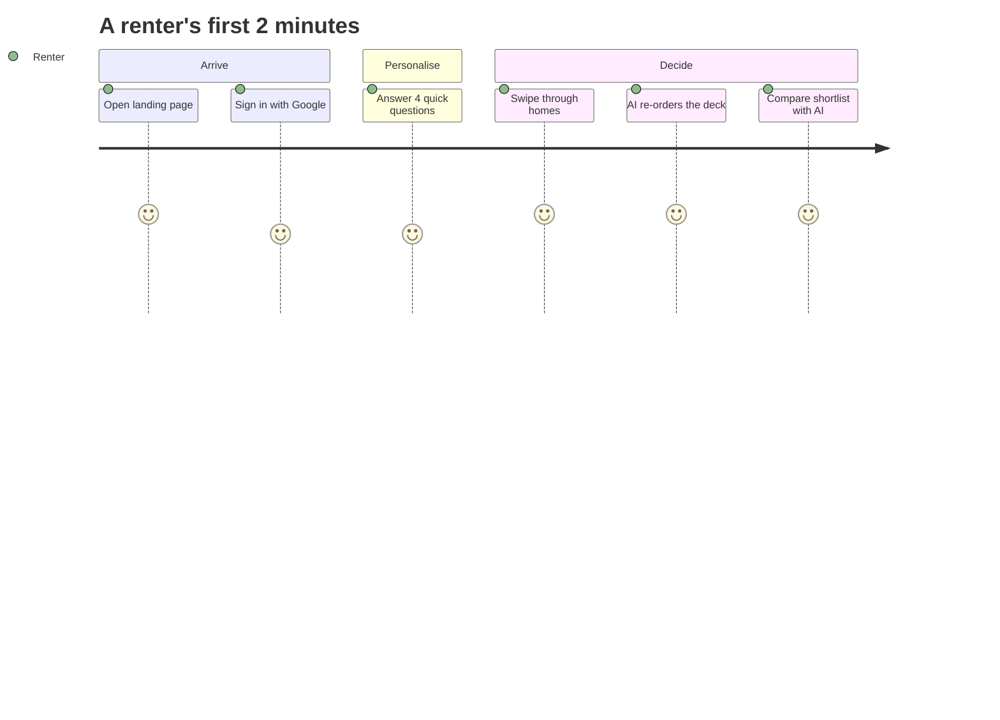

# 09 — README Blueprint + Portfolio Checklist (do this LAST, Phase 10)

Goal: a README that makes a recruiter think "this is a real product" in 30 seconds.

## 1. Structure (copy this outline)
1. **Hero**: logo/wordmark, one-line pitch, badges, big hero GIF, buttons (Live demo • Video • Docs)
2. **Why PropSwipe?** 3 short bullets (problem, idea, result)
3. **Features** table with a small screenshot per feature
4. **Demo**: swipe GIF, 3D landing GIF, AI compare GIF
5. **How it works**: architecture diagram + AI sequence diagram (Mermaid, below)
6. **Tech stack**: badges + one line each on why
7. **Project structure** (trimmed tree)
8. **Getting started**: prerequisites (Node 24.12+), clone, `npm install`, `.env.local` table, `npm run dev`
9. **Environment variables** table (what / where to get it / public or secret)
10. **Security notes**: rules, token check, no secrets in client
11. **Quality**: Lighthouse screenshot, `npm run check`
12. **Roadmap** (honest list of what's next)
13. **What I learned** (3–5 lines — recruiters love this)
14. **License + author links**

## 2. Assets to capture (put in `docs/assets/`)
| File | What | How |
|---|---|---|
| `hero.gif` | 6–8 s: landing 3D hero moving, scroll a bit | ScreenToGif (Windows) or Kap (Mac). 1280x720, 15 fps, under 8 MB |
| `swipe.gif` | swipe right, left, filters changing | same tool, crop to the deck |
| `ai-compare.gif` | liked panel -> Compare with AI -> result | same |
| `copilot.gif` | open copilot, ask, streamed answer | same |
| `mobile.png` | phone-size screenshot (browser device mode 390x844) | Chrome DevTools -> device toolbar |
| `detail.png`, `onboarding.png`, `filters.png` | one clean screenshot each | 1600x900, dark, no personal data |
| `lighthouse.png` | Lighthouse scores for `/discover` | Chrome DevTools -> Lighthouse |
| `demo.mp4` | 60–90 s walkthrough | drag it into a GitHub issue/PR comment to get a hosted link, paste that link in the README |
Tips: shrink GIFs with gifski or ezgif.com; keep each under 8 MB; use the live site with demo data only.

## 3. Badges (shields.io, plain Markdown)
```md


```
(Replace numbers with what is true on the day.)

## 4. Diagrams (GitHub draws Mermaid automatically)
Use the two diagrams from `docs/03-Technical-Architecture.md` (system + rerank sequence), plus this user journey:

And a "graph" for the README: a small table or a Lighthouse screenshot. A Mermaid `pie` chart for "AI features working vs fallback" is not honest unless measured; only add charts that show real numbers.

## 4b. Optional repo-stat widgets
Skip third-party stat images (they can break or slow the page). Prefer your own screenshots.

## 5. Portfolio checklist
- [ ] Repo is public, has a clear description + topics (nextjs, firebase, gemini, three-js, real-estate)
- [ ] Pinned repo on your GitHub profile
- [ ] Live demo link works for a stranger (Google sign-in works on the live domain)
- [ ] No secrets in history (`git log -p | grep -i "api_key"` returns nothing sensitive)
- [ ] README GIFs load fast
- [ ] A 60–90 s demo video
- [ ] LinkedIn post with the hero GIF + 3 lines on what you learned
- [ ] Resume bullet (example): *Built PropSwipe, a full-stack rental discovery app (Next.js 16, Firebase, Gemini) with swipe UX, AI re-ranking, shortlist comparison and a streaming copilot; secured with Firestore rules and token-verified API routes.*
- [ ] You can answer: "Why Firestore? Why server-side AI? How do you stop abuse? What would you do next?"

## 6. Prompt for the README build (give to Gemini at the end)
> Read AGENTS.md and docs/09-README-Blueprint.md. Write README.md following section 1. Use only features that exist in the repo today (check the code). Insert image paths from docs/assets/ (leave a clear `TODO` comment where a file is missing). Include the Mermaid diagrams. Keep language simple and friendly. Do not invent metrics.
Then bring the draft to Claude for a final polish and honesty check.
